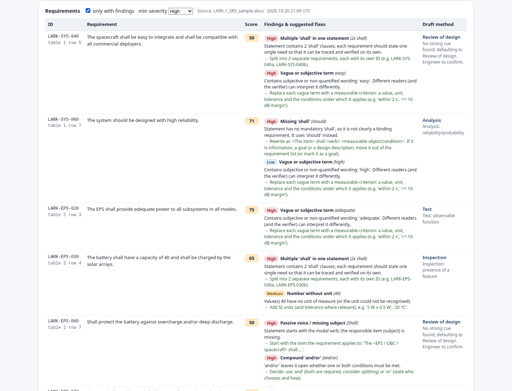

# ECSS Copilot

[](https://github.com/intelligent-design-llc/ecss-copilot/actions/workflows/ci.yml) [](LICENSE)

**An open-source requirement-quality checker and verification-matrix drafter for space projects that follow ECSS-style requirement practice.**

Upload a requirements specification (DOCX, PDF, CSV, XLSX, ReqIF) or paste text. ECSS Copilot extracts the individual requirements, flags common quality problems (vague terms, multiple "shall", open TBDs, missing units, unverifiable wording and more) with a suggested fix for each, drafts a verification method per requirement (Test / Analysis / Review of design / Inspection), and exports everything to Excel.

It runs fully offline with rule-based checks. An LLM pass for suggested rewrites is optional and works with any OpenAI-compatible endpoint, including local models.

> **Status:** early prototype (v0.1). Expect false positives. Feedback and contributions are welcome.



---

## ⚠️ Disclaimer

- **Advisory only.** All output is a draft for engineering review. It does not replace engineering judgement, product-assurance review or customer approval, and it requires human sign-off. The software is provided "as is" without warranty (see [LICENSE](LICENSE)).
- **Not affiliated with ECSS or ESA.** This is an independent project, not affiliated with, endorsed by or sponsored by the European Cooperation for Space Standardization (ECSS), the European Space Agency (ESA) or any other agency. "ECSS" only names the standards family the checks are inspired by.
- **No ECSS text is included.** The rules are our own paraphrase of widely known requirement-writing principles, such as the characteristics of good requirements described in ECSS-E-ST-10-06 and general systems-engineering guidance. Obtain the standards themselves from the official ECSS website.
- **Do not upload ITAR/EAR-controlled, otherwise export-controlled, or classified data,** or confidential data you are not authorised to process. This is especially important when you enable the LLM pass, which sends requirement text to the endpoint you configure.

---

## Features

- **Extraction:** DOCX (tables and paragraphs), PDF with a text layer, CSV, XLSX, TXT/Markdown, ReqIF (best effort) and pasted text. Keeps existing IDs (e.g. `SYS-PWR-010`) and generates `AUTO-nnn` IDs where none exist.
- **18 quality rules** (15 per requirement, 3 per document). Each finding has a severity (High / Medium / Low), an explanation and a suggested fix, and each requirement gets a 0–100 quality score.
- **Draft verification matrix:** a primary and optional secondary method per requirement with a rationale, clearly marked as a draft.
- **Optional LLM pass:** rewrites flagged requirements and refines the verification method. Only flagged requirements are sent, and only after you confirm.
- **Excel export:** Summary (with disclaimer), Requirements (with a reviewer-decision drop-down), Findings, Verification Matrix (T/A/R/I columns) and Rules.
- **Stateless:** uploads are processed in memory and are not stored.

## Quickstart

Requires Python 3.10 or later.

```bash
git clone <this-repo-url> ecss-copilot
cd ecss-copilot
./run.sh                      # creates .venv on first run, then serves http://127.0.0.1:8000
```

Manual alternative:

```bash
python3 -m venv .venv
.venv/bin/pip install -r requirements.txt
.venv/bin/python -m ecss_copilot          # HOST / PORT env vars override 127.0.0.1:8000
```

Try it with the synthetic sample spec in [`samples/`](samples/) (`LARK-1_SRS_sample.docx`, `.pdf` or `.csv`), which describes a fictional 3U CubeSat and contains deliberate flaws.

### Docker

```bash
docker build -t ecss-copilot .
docker run --rm -p 127.0.0.1:8000:8000 ecss-copilot
```

The app has **no authentication**. Keep it bound to localhost, or put it behind an authenticating reverse proxy if you expose it on a network.

## LLM configuration (optional)

Without these variables the app is rule-based only and nothing leaves the machine.

| Variable | Example | Notes |
|---|---|---|
| `LLM_BASE_URL` | `http://localhost:11434/v1` | Any OpenAI-compatible Chat Completions base URL (local Ollama/vLLM, or a hosted provider) |
| `LLM_API_KEY` | `...` | Optional for local servers |
| `LLM_MODEL` | `llama3.1:70b` | Model name as the endpoint expects it |

```bash
cp .env.example .env    # edit, then:
set -a; . ./.env; set +a; ./run.sh
# Docker: docker run --rm --env-file .env -p 127.0.0.1:8000:8000 ecss-copilot
```

Check your provider's data-retention and data-residency terms before you send any project data. If an LLM call fails, the rule-based results are kept.

## Rule catalogue

| ID | Check | Severity |
|---|---|---|
| RQ-01 | Missing "shall" (statement isn't clearly binding) | High |
| RQ-02 | Multiple "shall" in one statement (split it) | High |
| RQ-03 | Vague or subjective term (adequate, fast, user-friendly, as appropriate, …) | High (Low for mild terms such as *high*/*low*) |
| RQ-04 | Open item: TBD / TBC / TBS / "to be determined" | High |
| RQ-05 | Escape clause (if possible, as far as possible, where practicable, …) | High |
| RQ-06 | Unverifiable absolute (never, always, under all conditions, 100 %, …) | High |
| RQ-07 | Weak or mixed modal verb (should / may / will alongside shall) | Medium |
| RQ-08 | Missing subject (High) / passive voice without an agent (Low) | High / Low |
| RQ-09 | "and/or" (High) / ambiguous slash construction (Low) | High / Low |
| RQ-10 | Number without a unit | Medium |
| RQ-11 | Open-ended list (etc., such as, including but not limited to) | Medium |
| RQ-12 | Negative requirement ("shall not …") | Low |
| RQ-13 | Statement too long (> 45 words) | Low |
| RQ-14 | Ambiguous pronoun (it, they, this, …) | Low |
| RQ-15 | Design solution stated as a requirement ("shall use …") | Low |
| DOC-01 | Duplicate requirement ID | High |
| DOC-02 | Duplicate requirement text | Medium |
| DOC-03 | Missing requirement ID | Medium |

Verification-method heuristics are in [`ecss_copilot/verification.py`](ecss_copilot/verification.py). They are keyword-based: for example, environmental and functional wording points to Test, lifetime and reliability to Analysis, marking and dimensions to Inspection, and compliance and architecture wording to Review of design.

## Development

```bash
.venv/bin/pip install -r requirements-dev.txt
.venv/bin/python -m pytest -q
.venv/bin/python scripts/make_sample.py     # regenerate samples/ (PDF needs LibreOffice)
.venv/bin/python scripts/demo.py            # screenshots + XLSX into demo/ (needs playwright + chromium)
```

```
ecss_copilot/   extract.py  rules.py  verification.py  llm.py  export.py  core.py  app.py  static/index.html
tests/          pytest suite (rules, extraction, verification, export, API, mocked LLM)
scripts/        sample generator, demo runner
samples/        synthetic LARK-1 sample spec (fictional)
```

See [CONTRIBUTING.md](CONTRIBUTING.md) for how to propose rules and report false positives.

## Limitations

- Heuristic and English-only. There is no NLP model in the rule engine, so expect some false positives and negatives.
- PDFs need a text layer (no OCR). Tables in PDFs are reconstructed line by line.
- ReqIF import is best effort. ReqIF export is not implemented yet.
- No authentication, user management or persistence. Intended for local or single-user use.
- The verification methods are drafts based on wording, not on project context (verification level, stage, model philosophy).

## Roadmap

See [ROADMAP.md](ROADMAP.md). Highlights:
- **v0.2:** compliance matrix (C/PC/NC) against a standard **you supply** (bring your own copy; no standard text redistributed), with clause citations
- **ReqIF export** and traceability checks
- **Docker / self-hosted** image with a local open-weights model option
- **EU-hosted LLM option** with documented configuration

## License

Apache License 2.0, © 2026 Intelligent Design LLC. See [LICENSE](LICENSE) and [NOTICE](NOTICE).
